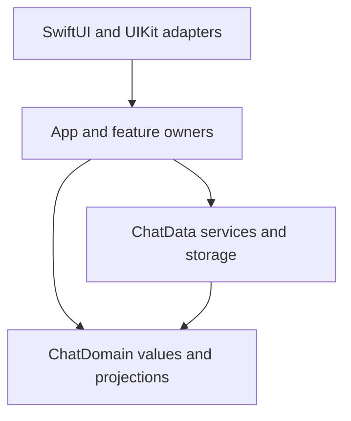

# iOS Development

Build native features around an explicit domain, authenticated scope, and
lifecycle owner. Use the PWA to check product semantics and shared contracts;
use native APIs for editing, navigation, accessibility, and presentation.

## Select the Relevant Guide

| Changed behavior                                                       | Guidance                                                                                                                               |
| ---------------------------------------------------------------------- | -------------------------------------------------------------------------------------------------------------------------------------- |
| State graphs, resource reads, commands, subscriptions, or cancellation | [iOS ccstate](ios-ccstate.md)                                                                                                          |
| Colors, typography, icons, controls, layout, or native interaction     | [Mobile Design System](mobile-design-system.md)                                                                                        |
| Test boundaries, fixtures, waiting, or native acceptance               | [iOS testing](ios-testing.md) and [shared testing](../testing.md)                                                                      |
| Event replay, optimistic input, or reconciliation                      | [Chat contracts](../chat.md#event-sourcing-and-optimistic-events)                                                                      |
| Requests, persisted formats, or supported client versions              | [Deployment compatibility](../deployment-compatibility.md)                                                                             |
| Error defaults, unavailable references, or recovery paths              | [Code quality](../bad-smell.md), [external references](../bad-smell.md#externally-managed-references), and [fallbacks](../fallback.md) |
| Build commands, signing, CI, or distribution                           | [iOS README](../../ios/README.md), [archive promotion](../../ios/ARCHIVE_PROMOTION.md), and [TestFlight](../../ios/TESTFLIGHT.md)      |

Keep setup and operating commands beside the component. Keep reusable rules in
these guides. Feature inventories, migration plans, profiling results, and
acceptance receipts belong in the owning issue or PR, as defined by the
[documentation boundary](../docs.md#documentation-boundary).

## Dependency Direction

| Owner                               | Responsibilities                                                                                               | Boundary                                                                                            |
| ----------------------------------- | -------------------------------------------------------------------------------------------------------------- | --------------------------------------------------------------------------------------------------- |
| `Packages/ChatDomain`               | Domain values, structured message semantics, pure projection and replay                                        | Foundation only; no App, HTTP, SQLite, UI, authentication SDK, or state-graph dependency            |
| `Packages/ChatData`                 | Canonical API transport and DTO conversion, synchronization, mutation services, durable storage                | Depends on ChatDomain and system frameworks; no App/UI or identity/realtime SDK dependency          |
| `Okou/App` and feature owners       | Authenticated scope composition, resource graphs, semantic actions, drafts, selection, and operation lifetimes | Depend on public Domain/Data APIs; keep wire and storage implementation details behind their owners |
| `Okou/Services` and native adapters | Authentication/realtime SDKs and OS capabilities                                                               | Adapt external callbacks into scoped operations; keep SDK types out of Domain/Data contracts        |
| SwiftUI/UIKit and `DesignSystem`    | Projection, native controls, editing, focus, accessibility, measurement, and reusable presentation             | Forward business actions to owners; use shared native tokens and components                         |
| `Push`                              | Notification extension entry, identity validation, bounded background synchronization, and completion          | Separate process and OS lifetime; reuse Domain/Data contracts rather than App view ownership        |

The package manifests enforce part of this direction. App folder names alone
do not enforce it: trace actual imports and consumers. The component-local
[chat architecture](../../ios/CHAT_UI_ARCHITECTURE.md) explains the transcript,
cache, and rendering implementation.

Do not move an operation into a package merely to make its test easier. Extract
a boundary when its responsibility and callers justify it. Prefer an existing
owner over a new repository, service, Store, or universal base class.

## Choose the State Owner

Choose the lifetime before choosing a property wrapper.

| State or work                                                                      | Preferred representation                                                                                                      |
| ---------------------------------------------------------------------------------- | ----------------------------------------------------------------------------------------------------------------------------- |
| Independently editable domain input or invalidation revision                       | Private CCState `State` within the owning graph                                                                               |
| Value fully determined by other graph values                                       | `Computed`; do not maintain it with synchronization callbacks                                                                 |
| Repeatable, shared asynchronous read                                               | `Computed<Task<Value, Error>>`, observed through CCStateSwiftUI where applicable                                              |
| Semantic graph transition                                                          | A stable `Command`; compose graph writes inside that action                                                                   |
| Confirmed business snapshot, delivery, authorization, or persistence state machine | The existing feature owner, using explicit domain phases and reconciliation; CCState may represent its inputs and derivations |
| View-local sheet selection, focus, gesture, scroll, or native editor machinery     | Native SwiftUI/UIKit state or a narrowly owned observable adapter                                                             |
| HTTP, SQLite, decoding, or serialized synchronization                              | Existing ChatData services and actors; a graph coordinates them rather than replacing them                                    |

`@Observable` is not itself a defect, and CCState is not a replacement for every
actor or native object. Conversely, wrapping an existing `data/loading/error`
tuple in an observable object does not make it the authoritative request
lifecycle. Follow the [resource rules](ios-ccstate.md#resource-reads) for new or
changed resource reads.

Distinguish these scopes:

- **Application/system:** a genuinely application-owned SDK or OS bridge.
- **Authenticated workspace:** immutable API origin and authenticated identity;
  shared resources and workspace feature owners close on scope replacement.
- **Conversation or draft:** thread/Agent identity, local input, delivery and
  persistence, including work that must survive a view temporarily disappearing.
- **Presentation or operation:** a search presentation, authorization attempt,
  preview, or other explicitly bounded interaction.
- **Mounted native control:** selection, marked text, observers, and other
  resources that actually belong to that control.

Do not rebind an owner to a different account/workspace while work is in flight.
Replace it and close its old work. Keep durable cache identity distinct from a
renewable session credential; token renewal alone need not discard confirmed
data. Never let a process-wide singleton or keyed cache silently share
identity-scoped state.

## Write Features Around Semantic Actions

1. Identify the production entry point, domain contract, identities, and owner.
2. Reuse the existing Domain/Data operations and native components. Compare the
   corresponding PWA behavior where both clients implement the same feature.
3. Derive presentation values from their authoritative inputs. Give an action a
   semantic name such as send, save, retry, cancel, or select; the view forwards
   the intent rather than coordinating several low-level writes.
4. Keep the action's validation, I/O, confirmation, invalidation, and failure
   outcome together. A sheet opening or a child mounting must not become an
   accidental continuation of a business command.
5. Add only verification that proves the affected caller contract, then perform
   native acceptance for changed native behavior.

Construct graph definitions and long-lived owners outside SwiftUI `body` and
UIKit update callbacks. Repeated rendering must not create another graph,
start an imperative request, write state, or acquire a subscription. Observing
an existing lazy resource is allowed; its graph owns request creation.

Use `.task(id:)` when the committed view and its identity really own the work.
Do not move workspace work into an arbitrary child task merely to obtain a
cancellation hook. Opacity, off-screen placement, and navigation retention do
not establish owner destruction.

## Concurrency and External Boundaries

Keep UI and CCState graph access on `MainActor`. Use existing service/storage
actors for network processing, replay, and disk access; declaring an operation
`async` does not make CPU work run off the main actor. Preserve Sendable and
actor-isolation checks. An unchecked conformance needs a concrete synchronization
or external callback contract, not just a compiler error to silence.

Every asynchronous operation has a trigger, an owner, a completion/failure
path, and teardown. Await finite composition. Retain and cancel work that must
outlive its caller at the correct owner; `[weak self]` alone is not cancellation.
After suspension, verify cancellation and the identity that is still allowed
to publish. See [native cancellation](ios-ccstate.md#cancellation-and-teardown)
for shared Tasks and late remote cleanup.

Canonical application requests use ChatData's `APIClient` and typed service
operations. Preserve fresh scoped token provision, client/version headers,
structured status/code information, and the force-upgrade boundary. A known
HTTP 426 closes/blocks affected workspace work; a generic retry or stale-data
display must not bypass it.

Public assets, signed transfers, and external web previews use their dedicated
adapters. They must not acquire application credentials or client identity
headers just because they were initiated from an authenticated screen. Keep
authorization decisions with the authoritative service; a locally stored ID or
decoded token claim cannot grant access.

Keep transient read recovery separate from mutations. Use the existing bounded
read-recovery policy for eligible reads; do not automatically replay Send,
permission changes, resets, or other writes after an ambiguous failure.
Preserve idempotency identity and readback/reconciliation where the operation
requires them. Do not replace an authorization protocol or a persistence state
machine with a generic loading flag.

Preserve recoverable HTTP, disk, authentication, and permission errors. Do not
turn them into successful empty/default data with `try?`, or terminate the app
with an invariant failure. A fail-fast local graph invariant must be justified
by its non-failing inputs and derivations, rather than applied to external I/O.

## Native Presentation and Persistence

The PWA is a reference for product meaning, wire contracts, and shared color
roles. Mobile owns geometry, UIKit/SwiftUI composition, system authorization,
and native editing. Apply the [Mobile Design System](mobile-design-system.md)
for components, generated assets, accessibility, and native interaction.
Keep marked text, UTF-16 selection, undo, first responder, gesture
arbitration, and scroll anchors with their native owners. A graph migration
does not authorize changing those contracts.

Use the existing String Catalog and localized SwiftUI/Foundation APIs for new
product copy. Keep dynamic user content verbatim and preserve interpolation;
do not concatenate translated fragments or hard-code a screen's language.
Preserve accessible names, native text scaling, and Reduce Motion behavior.

Keep durable snapshots/cursors in the data layer and disposable render or
measurement caches with their presentation owner. Realtime invalidations trigger
authoritative reads; transient streaming output must reconcile to durable event
identity. Preserve pending input and dirty persisted work until the owning
business contract allows release.

Every keyed cache needs an identity, a retention bound, invalidation, and a
release path. A workspace lifetime is not a size bound for a dictionary that
can grow for hours. Specify whether a bound is hard, soft with protected work,
or advisory, such as `NSCache`; do not describe an estimated cache cost as a
process-memory limit. Ordinary computed memoization does not need a second
dictionary of the same results.

## Verification and Review

Use [iOS testing](ios-testing.md) for production entry points, external fixtures,
causal waits, isolation, and native acceptance. Use the [README](../../ios/README.md)
for commands and [Swift checks](../../ios/AGENTS.md#swift-checks) for formatter
and lint ownership. Keep existing safety rules; a new baseline, suppression, or
excluded directory is not a repair.

For an optimization, record a reproducible interaction, source revision,
toolchain/runtime/device, fixture or data scope, and comparable before/after
measurements. Distinguish startup/request dependencies, main-thread CPU,
render/layout work, retained memory, and complete CI duration. Explain the
mechanism supported by the measurement. Simulator timing does not establish
device performance; fewer properties or lines do not establish a speedup.

Review state ownership, resource cancellation, cache bounds, confirmed-write
semantics, and native interaction explicitly. SwiftLint currently checks the
safety rules configured in `ios/.swiftlint.yml`; it does not enforce CCState
ownership. A lint pass, successful build, passing tests, native acceptance,
release availability, and observed production behavior are separate evidence.
